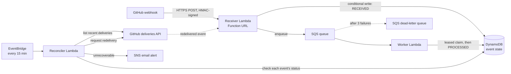
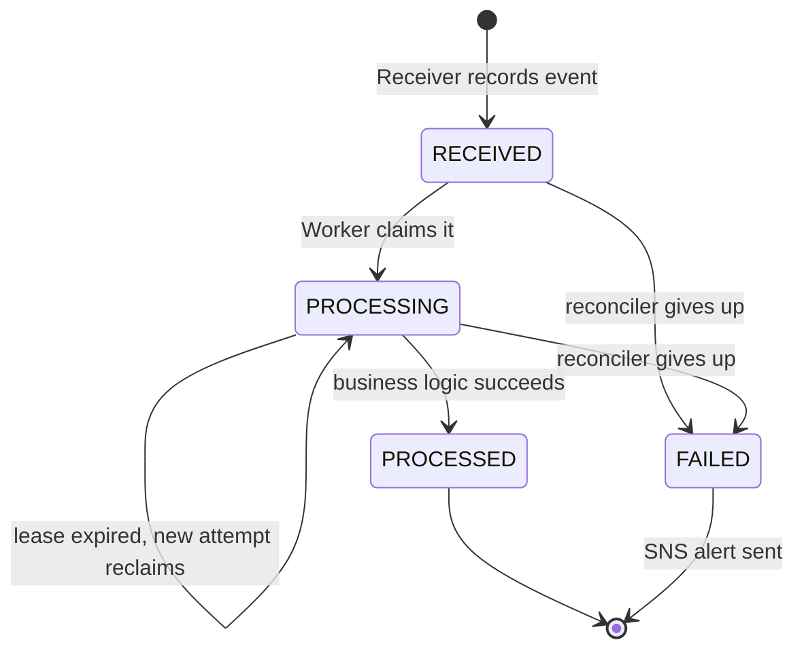

# ResilientHook

**A self-healing webhook ingestion pipeline on AWS.** It detects webhook events that were lost in transit or crashed mid-processing, recovers them automatically, and guarantees each one is processed effectively once.

In fault-injection tests across 604 events, **100% of the 145 events lost or crashed were recovered, with 0 duplicates**, running at **$0/month** on the AWS free tier.

<!-- Record a 60–90s demo and save it as docs/demo.gif -->
<!--  -->

---

## The problem

Webhooks are fire-and-forget. If your endpoint is down, slow, or crashes after accepting an event, that event is often gone for good:

- **GitHub does not automatically retry failed webhook deliveries.** A single 5xx response and the event is lost unless someone notices and redelivers it by hand.
- Even when a delivery succeeds, your own processing can crash halfway, leaving the event recorded but never acted on, with nothing to signal that anything went wrong.

The usual fix is a hand-written midnight script that polls the provider's API to find what was missed. ResilientHook builds that into the architecture: it **continuously reconciles** what the provider sent against what was actually processed, and heals the difference.

## How it works



1. **Receiver.** Verifies the HMAC-SHA256 signature over the raw body, records the event in DynamoDB with a conditional write keyed on GitHub's delivery ID, and enqueues it to SQS. If enqueueing fails it returns 503, so the failure is visible on GitHub's side.
2. **Worker.** Claims the event with a conditional update (`RECEIVED → PROCESSING`), runs the business logic, and marks it `PROCESSED`. Only failed messages in a batch are retried.
3. **Reconciler.** Every 15 minutes it lists recent deliveries from GitHub and compares them against DynamoDB:
   - **Missing:** GitHub saw a non-2xx and no row exists, so the event never arrived.
   - **Stuck:** the row has been `RECEIVED` or `PROCESSING` for over 10 minutes, so processing never finished.

   For either case it asks GitHub to **redeliver** the event, which then flows through the normal Receiver path. There's one code path for new and recovered events, and no payloads need to be stored.
4. **Give up loudly.** After 3 redelivery attempts, or for events older than GitHub's retention window, the event is marked `FAILED` and an SNS email alert goes out, once per event.

### Event lifecycle



## Results

Each scenario fired 150 GitHub issue comments (plus the issue-opened event) while injecting failures, then let the system recover. Failures were injected with a `FAIL_RATE` switch on each Lambda. Receiver failures reject the delivery with a 503 before recording it, simulating an outage. Worker failures crash after claiming the event, leaving it stuck in `PROCESSING`.

| Scenario | Receiver fail | Worker fail | Events | Lost | Crashed | Recovered | Unrecoverable | Duplicates | Recovery rate | Median recovery | Max recovery |
|---|---|---|---|---|---|---|---|---|---|---|---|
| baseline | 0% | 0% | 151 | 0 | 0 | 0 | 0 | 0 | n/a | - | - |
| outage | 20% | 0% | 151 | 28 | 0 | 28 | 0 | 0 | 100% | 213s | 382s |
| crashes | 0% | 30% | 151 | 0 | 43 | 43 | 0 | 0 | 100% | 180s | 360s |
| combined | 20% | 30% | 151 | 33 | 51 | 74 | 0 | 0 | 100% | 180s | 477s |

- **Lost** means GitHub's first delivery got a non-2xx. GitHub would never have retried these.
- **Crashed** means the Worker claimed the event more than once because an earlier attempt died.
- **Duplicates** means events whose business logic completed more than once, counted from Worker logs with CloudWatch Logs Insights.
- In *combined*, 10 events were both lost and later crashed, so affected = 74, not 84. Some of the lost events were redelivered by the **scheduled** reconciler run during the test, not by the test harness.

**About recovery times:** the test harness invoked the reconciler every 60 seconds to keep runs short. Crash recovery is bounded by the SQS visibility timeout (180s per retry), which is why the median is exactly 180s. In production, the worst case is set by the schedule: a missing event waits up to **15 minutes** for the next run, and a stuck event up to about **25 minutes** (the 10-minute stuck threshold plus the schedule). That's a deliberate trade-off against API calls and cost. See *Design decisions*.

Reproduce with `python scripts/chaos_test.py --name <scenario> [--receiver-fail X] [--worker-fail Y]`.

## Design decisions

**Reconcile on status, not existence.** An early design checked only whether an event existed in DynamoDB. That leaves a silent-loss path: the Receiver records the event, then crashes before enqueueing it. The row exists, so the reconciler would skip it forever. Reconciling on *status* catches events that arrived but never finished.

**`PROCESSING` is a lease, not a state.** If a Worker crashes after claiming an event, a plain `PROCESSING` state would block every retry. Instead, each claim records `processing_started_at`, and a claim older than 60 seconds can be taken over. The lease (60s) is longer than the Worker timeout (30s), so a slow but live Worker isn't interrupted. It's shorter than the SQS visibility timeout (180s), so the next SQS retry can always reclaim it.

**Effectively-once, not exactly-once.** Delivery is at-least-once: the same event can arrive through SQS retries, redeliveries, or both. Every state transition is a DynamoDB conditional write, so only one attempt can claim and complete an event. This gives effectively-once processing of state. Business logic with *external* side effects, like sending an email, could still repeat if a Worker crashes after the side effect but before marking `PROCESSED`. Real side effects would need their own idempotency keys.

**Recover through the provider's redeliver API.** Rather than storing payloads and replaying them, the reconciler asks GitHub to redeliver. Recovered events go through signature verification and the same code path as new ones, and storage stays small. A redelivery keeps the original delivery ID, so the Receiver re-enqueues events in `RECEIVED` or `PROCESSING` instead of ignoring them as duplicates.

**Bounded retries, then a human.** Retries are capped at every layer: 3 SQS receives before the DLQ, then 3 reconciler redeliveries. After that the event is marked `FAILED` and an alert is sent. The alert is conditional on the status change, so each event alerts exactly once.

**Recovery window.** GitHub keeps webhook delivery history for about 3 days, so the reconciler looks back 70 hours. Events stuck since before that window can't be redelivered; they're marked `FAILED` with reason `outside_retention_window` and alerted rather than silently dropped.

**Free tier by design.**

| Choice | Instead of | Why |
|---|---|---|
| Lambda Function URL | API Gateway | Free HTTPS endpoint; the HMAC check is the real auth |
| SSM Parameter Store (Standard) | Secrets Manager | No per-secret charge |
| DynamoDB provisioned (table 5R/10W + GSI 5R/10W) | On-demand | Stays inside the always-free 25 RCU / 25 WCU |
| GSI on `status` + `received_at` | Table scans | The reconciler queries stuck rows cheaply |
| EventBridge scheduled rule every 15 min | Per-minute polling | Fewer invocations and GitHub API calls |
| 7-day log retention, 7-day row TTL | Defaults (forever) | Storage never grows unbounded |
| No VPC | VPC Lambdas | Avoids a NAT Gateway (about $33/month minimum) |

## Limitations and next steps

- **Public endpoint cost exposure.** Requests with invalid signatures are rejected but still invoke the Receiver, so a flood of junk requests could exceed the free tier. Next step: a WAF or a reserved-concurrency cap.
- **DLQ visibility.** Messages in the DLQ are recovered by the reconciler, but there's no alarm on DLQ depth yet. Next step: a CloudWatch alarm sent to the existing SNS topic.
- **Single provider.** Only GitHub is implemented. The reconciler's list-deliveries and redeliver calls are the only provider-specific pieces, so Stripe or Razorpay would mean adding an adapter.
- **Tests.** Behavior is verified end to end with the chaos test. Unit tests (pytest + moto) and CI are planned.

## Project structure

```
resilienthook/
├── app.py                          # CDK app entry point
├── resilienthook/
│   └── resilienthook_stack.py      # All infrastructure (table, queues, Lambdas, schedule, alerts)
├── lambdas/
│   ├── receiver/handler.py         # Signature check, idempotent record, enqueue
│   ├── worker/handler.py           # Leased claim, business logic, complete
│   └── reconciler/handler.py       # Detect missing/stuck events, redeliver, alert
├── scripts/
│   ├── chaos_test.py               # Fault-injection test harness + metrics
│   └── set_fail_rate.py            # Toggle fault injection without redeploying
└── results/                        # Chaos test output (summary.md + per-run JSON)
```

## Deploy it yourself

**Prerequisites:** an AWS account, AWS CLI, Node.js, AWS CDK, Python 3.12, and the GitHub CLI (`gh`).

1. **Clone and install.**
   ```bash
   git clone https://github.com/ilakyadhinakaran/resilienthook && cd resilienthook
   python -m venv .venv && source .venv/bin/activate
   pip install -r requirements.txt -r requirements-dev.txt
   ```
2. **Create a test repo and secrets.**
   - Create a repo to generate events: `gh repo create resilienthook-test --private`
   - Create a fine-grained GitHub token scoped to that repo with **Webhooks: Read and write**, then store it and a webhook secret:
   ```bash
   aws ssm put-parameter --name /resilienthook/github-token --type SecureString --value "<token>"
   aws ssm put-parameter --name /resilienthook/webhook-secret --type SecureString --value "$(openssl rand -hex 32)"
   ```
3. **Configure and deploy.** Edit the constants at the top of `resilienthook/resilienthook_stack.py` (`GH_OWNER`, `GH_REPO`, `ALERT_EMAIL`), then:
   ```bash
   cdk bootstrap && cdk deploy
   ```
   Confirm the SNS subscription email.
4. **Connect the webhook.** Use the `ReceiverUrl` from the deploy output:
   ```bash
   gh api repos/<owner>/resilienthook-test/hooks \
     -f name=web -F active=true -f 'events[]=*' \
     -f "config[url]=<ReceiverUrl>" -f 'config[content_type]=json' -f "config[secret]=<webhook-secret>"
   ```
   Put the returned hook `id` into `GH_HOOK_ID` in the stack and redeploy.
5. **Run a chaos test.**
   ```bash
   python scripts/chaos_test.py --name outage --receiver-fail 0.2
   ```

**Tear down:** `cdk destroy` removes everything except the SSM parameters.

## Tech stack

AWS Lambda (Python 3.12, ARM64) · Amazon SQS · Amazon DynamoDB · Amazon EventBridge · Amazon SNS · AWS Systems Manager Parameter Store · CloudWatch Logs Insights · AWS CDK (Python) · GitHub Webhooks and REST API
